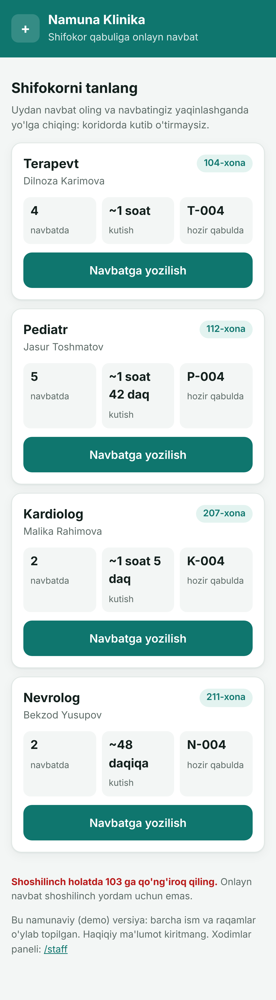
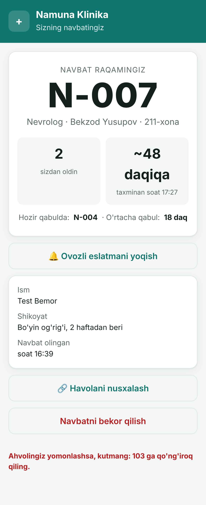
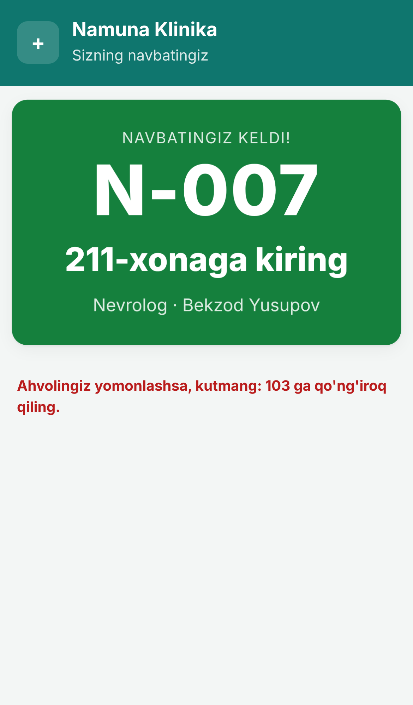
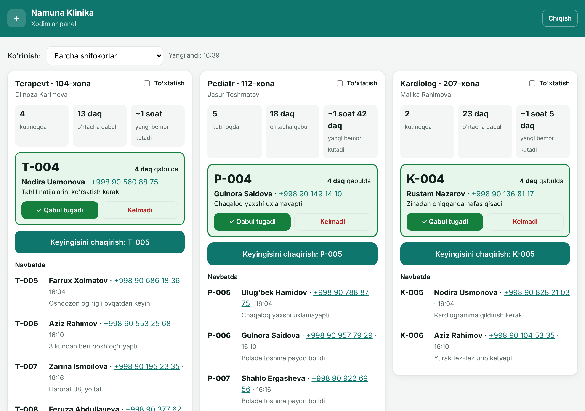

# Week 01: Navbat (online clinic queue)

> Patients book a place in a doctor's queue **from home**, watch their position and estimated wait live on their phone, and leave for the clinic when it's nearly their turn instead of sitting in a crowded hallway.

**Category:** Real-life · **Mode:** 🤖 Autopilot · **Dates:** Mon Nov 9 – Sun Nov 15, 2026 · **Language:** Uzbek (Latin)

**Case:** a clinic, Social by AKFA. **Product owner:** A-zam. The demo runs as a fictional *Namuna Klinika* with made-up doctors and patients. The clinic name is one setting (`CLINIC_NAME`).

**▶ Demo:** _live link on Sunday_ · runs locally now (see below)

| Patient: choose a doctor | Patient: live ticket | Patient: "your turn" |
|---|---|---|
|  |  |  |



## The problem
At a walk-in clinic the queue only exists inside the building: you take your place by showing up. Patients arrive early, wait an hour or more in a hallway next to other sick people, and still have no idea how long is left. Reception keeps answering "how much longer?", and nobody knows how many people are on their way.

**Navbat** moves the queue online. You book from home, get a ticket like **T-014**, and the page tells you *"4 people ahead of you · about 45 min · around 14:35"*. When it's time, it tells you to set off.

## Screens

| Screen | Who uses it | What it does |
|--------|-------------|--------------|
| **Booking** (`/`) | Patient, at home | Pick a doctor (each card shows the live queue and wait), enter **name, phone, and complaint** → get a ticket |
| **Ticket** (`/t/<id>`) | Patient, on their phone | Live position, estimated wait and clock time, "time to set off" alert, "it's your turn, go to room 12" alert, cancel button |
| **Reception / doctor** (`/staff`) | Clinic staff, PIN-protected | Each doctor's queue with names, phones and complaints; **Call next**, **Done**, **No-show**, pause/resume |

## MVP scope (set on Monday)
**In:**
- [ ] Book a place in a chosen doctor's queue online, no account or app needed
- [ ] Required fields: **name, phone (+998), complaint**; one active booking per phone number per day
- [ ] Ticket page with live position, wait time and clock time, updated in real time
- [ ] Alerts: **"set off now"** (about 30 min before your turn) and **"it's your turn: room N"**
- [ ] Staff panel: call next, done, no-show, pause a doctor's queue
- [ ] **Wait-time estimate learned from each doctor's real consultation times**, not a hard-coded guess
- [ ] Whole interface in **Uzbek (Latin)**, mobile-first
- [ ] Demo clinic with seeded data, so anyone can try it in 30 seconds

**Out (on purpose):**
- Choosing a time slot in advance (this is a live queue, not a calendar)
- SMS / Telegram notifications (alerts work while the ticket page is open; a Telegram bot is the obvious v2)
- Phone number verification by code, patient accounts, medical records
- Russian-language version

## How the wait estimate works
Each doctor starts with a default consultation length (for example 15 min). Every finished consultation, measured from *called* to *done*, feeds into the estimate:

```
avg = (3 × default + sum of recent real durations) / (3 + number of durations)
```

With no data, the estimate equals the default. As real visits accumulate, the clinic's actual pace takes over. Durations under 2 min or over 60 min are ignored, since those usually mean staff forgot to press a button. A patient's wait is the time left on the current consultation plus `people ahead × avg`.

## Stack
- **Backend:** Node.js 22 + Express, using the built-in `node:sqlite`. One dependency, no native builds.
- **Real-time:** Server-Sent Events. Every change pushes an update, and pages refetch.
- **Frontend:** plain HTML/CSS/JS with no build step.

## Run it locally
Needs Node.js 22.5+.
```bash
cd weeks/01-queue-booking/app
npm install
npm start          # → http://localhost:3000  (staff panel: /staff, demo PIN 1234)
npm test           # 13 tests: queue rules, validation, privacy, wait-time maths
```
To try the whole flow, open the booking page on your phone (or in a narrow window) and `/staff` in another window. Book a ticket, then press **Keyingisini chaqirish** and watch the ticket page change without reloading.

| Setting | Default | Meaning |
|---|---|---|
| `PORT` | `3000` | |
| `STAFF_PIN` | `1234` | PIN for the staff panel |
| `CLINIC_NAME` | `Namuna Klinika` | Shown in every header |
| `DEMO` | on | `DEMO=0` starts with an empty database and no seeded doctors |
| `DB_PATH` | `app/navbat.db` | SQLite file |

## Privacy notes
- Public pages never show other patients' names, phones or complaints, only ticket codes and counts.
- Ticket links use random, unguessable IDs.
- A real deployment would need patient consent text, HTTPS, and servers located in Uzbekistan: Uzbek personal-data law requires citizens' personal data to be stored locally.

## Who did what
| | |
|---|---|
| **Human decisions** | Problem and category. Product-owner calls: a real clinic as the case, booking **from home** rather than at the door, Uzbek UI, collect name + phone + complaint, separate queue per doctor |
| **Delegated to AI** | Product brief from the owner's answers, data model, queue rules, wait-time estimator, API, all three screens, Uzbek copy, demo data, tests |
| **Verification** | 13 automated tests (queue flow, one booking per phone, validation, PIN, *no personal data on public endpoints*, estimator maths). A scripted browser walkthrough as patient (phone) and staff (laptop) checked that the ticket page updates live, the layout works at 320 px, and there are no JS errors. **Uzbek copy still needs proofreading by a native speaker** (product owner). |
| **Where AI was wrong** | **Phone field:** typing a number *with* the country code (`998 93 …`) was silently cut to the wrong number. Pasting worked, so it only showed up when the browser walkthrough typed digit by digit. Fixed and re-tested with four input styles. **Test command:** `node --test test/` doesn't accept a folder on Node 22, so the suite didn't run at first; it now uses a glob. |

## What's missing / next
- _Sunday_
