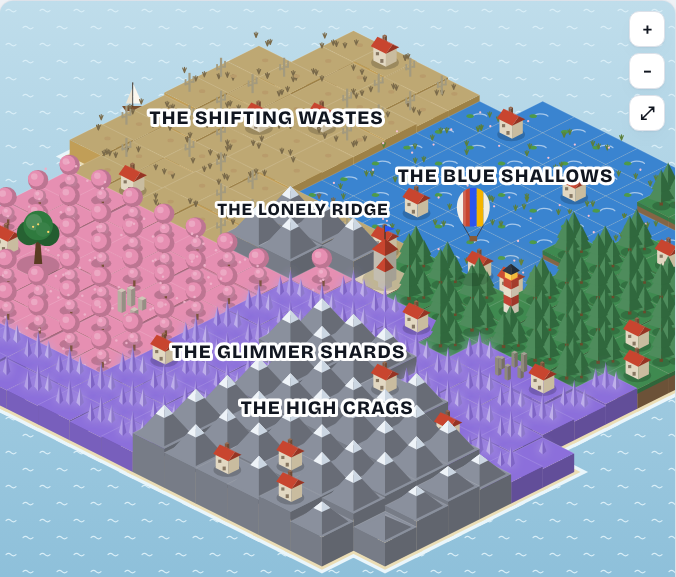
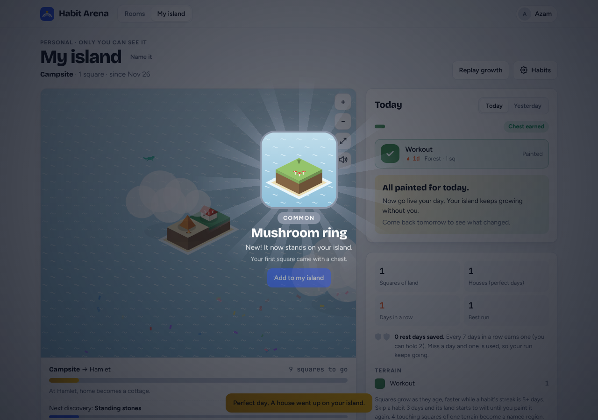
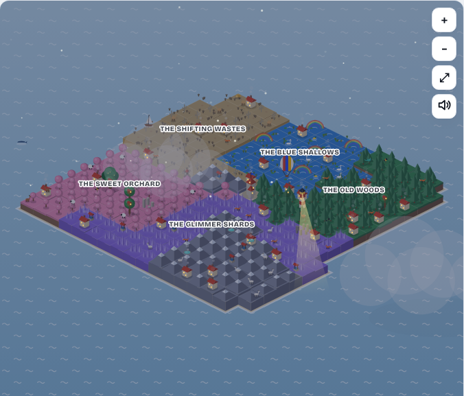

# Week 02: Habit Arena (competitive habit rooms)

> Make a room, invite friends with a code, and compete on shared habits. Every check-in earns XP, streaks multiply it, and a leaderboard shows who's keeping their promises.

**Category:** Micro-SaaS / Social · **Mode:** 🤖 Autopilot · **Dates:** Mon Nov 23 – Sun Nov 29, 2026

**🎓 Graduated:** the installable app now lives in its own repo, [a-zam/habit-arena](https://github.com/A-zam/habit-arena) (Vite PWA + Supabase). The [`app/`](app) folder here is the snapshot it started from.

**▶ Demo (MVP):** [Habit Arena on claude.ai](https://claude.ai/artifact/MD1PZZPu6CS3P5RrfcNRL5): private until shared from its Share menu

## The problem
Habit trackers are lonely. You tick boxes for a week and then stop, because nobody notices. Friend groups already try to fix this with group chats ("did everyone work out today?"), but there's no score, no streaks, and no record.

## MVP scope (set on Monday)
The plan is to ship it as a **claude.ai artifact** first, because sharing, sign-in and storage come built in. If people actually use it, it becomes a real app.

**In:**
- [x] Rooms with a 6-character join code and an invite link (`…#CODE`)
- [x] Shared room habits (up to 8) plus up to 3 personal habits per member (creator can turn these off)
- [x] Custom challenge length (start/end dates; upcoming → active → finished states)
- [x] XP: +10 per check-in, streak multiplier (×1.5 from day 3, ×2 from day 7, ×2.5 from day 14), +25 for a perfect day
- [x] Levels (Rookie → Mythic) and 10 badges
- [x] Honor system by default; the creator can require proof (a note or a photo)
- [x] Live leaderboard drawn as running lanes, activity feed, cheers
- [x] Check in for today or yesterday (forgot-to-log grace)
- [x] **My island** (personal tracker, private): every habit you complete adds one square of land, placed by you next to your existing land, on a 3D isometric island
  - each habit grows its own terrain (forest, lake, meadow, dunes, peaks, blossom, canyon, crystal)
  - **the world evolves:** squares mature over a week (saplings become forests, mountains grow snow caps), faster during a 5+ day streak; a habit skipped for 3 days **wilts** until you paint it again
  - perfect days build houses, which get bigger as perfect days add up; home grows with the realm (tent → cottage → tower → keep → castle)
  - **8 discoveries** that appear as you play: fishing boat, lighthouse, old ruins, standing stones, ancient tree, waterfall, hidden lagoon, hot-air balloon
  - **named regions:** 4+ touching squares of one terrain get a generated name ("The Whispering Woods"); you name the island itself
  - growth replay, save as image
- [x] **Engagement layer**, based on research ([RESEARCH.md](RESEARCH.md)):
  - **juice:** synthesized sound with a rising pitch ladder, particles, screen shake, "+1", confetti on a perfect day
  - **chests:** 20% per square, guaranteed on the first square, on a perfect day (better odds) and when reviving a wilting habit; 18 collectibles in 4 rarities that live on the island, with a collection book
  - **living world:** creatures moving around, windmills turning, chimney smoke, clouds, day/night on the local clock with lit windows, stars and a lighthouse beam
  - **forgiveness:** rest days (earn 1 per 7-day run, hold 2) instead of resets; wilting is always revivable
  - **reasons to come back:** morning report of overnight growth, "tomorrow N squares will grow", next-discovery progress bar
  - **social:** opt-in island sharing; visit friends' islands from a room's leaderboard
  - **ending:** "All painted for today, go live your day"

| Living island (sample data) | Chest reveal | Night |
|---|---|---|
|  |  |  |

**Out (on purpose):**
- Push reminders and notifications (needs a real app)
- Friend verification or voting on proof
- Cross-room profile or global level
- Weekly sub-seasons inside a long challenge

## How it works
One page; all data lives in the artifact's document store.

| Path | Who writes | What's in it |
|------|-----------|--------------|
| `rooms/<CODE>` | any player (UI: creator only) | name, dates, shared habits, proof/personal toggles |
| `rooms/<CODE>/members/<uid>` | the player | membership index, so the room can list who's in |
| `people/<uid>` | **only that player** (access rule) | player name |
| `people/<uid>/rooms/<CODE>` | **only that player** (access rule) | personal habits, check-in log, cheers given |
| `data/users/<uid>/tracker` | **only that player**, and nobody else can read it | My map: habits with terrain, and per day per habit the painted square `[x, y, time]` |

XP, streaks, levels and badges are **never stored**. They're recomputed from the check-in log by one pure `score()` function, so they can't drift and anyone can audit them. The leaderboard subscribes to each member's log doc live.

**My island** is drawn on a 2D canvas in isometric projection: blocks of different heights in painter's order, then trees, houses, discoveries and region labels. Like XP, everything is derived from the check-in log and nothing visual is stored. Growth stage comes from each square's age plus the habit's streak, and wilting from the habit's last check-in. Discoveries are found by **replaying** the log in the order squares were painted, so each one stays where it first appeared even as the island grows. Chest results are rolled once per check-in and stored (`finds`), so undoing and repainting can't re-roll. The static island is cached to an offscreen canvas; only the living layer (creatures, smoke, clouds, sky, particles) redraws, at about 30 fps, and it pauses when the map is off-screen or the tab is hidden. A new square must touch existing land, so the island's shape is the player's own.

Access rules: `people` is readable by everyone, and each `people/<uid>` subtree is writable only by its owner (`{self}` rule). Checked after publishing: a write into someone else's subtree is refused.

## Stack
- Single HTML file, vanilla JS, no build
- claude.ai artifact capabilities: `db` (document store and access rules), `user` (identity and names), `assets` (proof photos), `downloads` (save map image)
- Canvas 2D for the map (no libraries)

## Run it
Open the demo link. To edit: change `artifact/habit-arena.html` and republish it.

## Who did what
| | |
|---|---|
| **Human decisions** | The idea (social, shareable habit competition with XP); shared + personal habits; all XP mechanics; custom challenge length; honor system with optional proof as a room setting; artifact-first, app later |
| **Delegated to AI** | Data model and access rules, XP formula numbers, badge set, UI and visual design, full implementation |
| **Verification** | Headless-browser run against an in-memory mock store (create room, join, check in today and yesterday, cheer, phone width, dark mode, no console errors); live check that the access rule blocks cross-player writes |
| **Where AI was wrong** | First render leaked a literal "null" text node into the room view (`replaceChildren` doesn't skip nulls the way the element helper does); caught in the screenshot and fixed |

## What's missing / next
- Friends outside your claude.ai organization must be added as **Editors** in the Share menu to check in (Viewers can only watch). This sharing friction is the main argument for turning it into a standalone app.
- No reminders. A daily nudge is the first feature an app version needs.
